# Monkado

<p align="center">
  
</p>

<p align="center">
  <a href="https://github.com/monkey-land/monkado">
    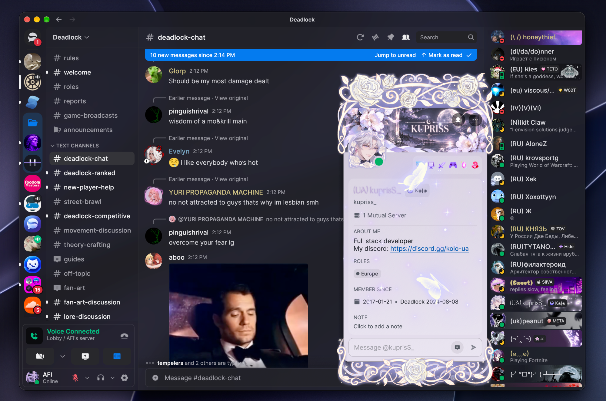
  </a>
</p>

<p align="center">
  <strong>Cliente de Discord nativo para Windows, leve e rápido, escrito em Rust com egui e wgpu — com compartilhamento de tela e câmera direto entre amigos.</strong>
</p>

<p align="center">
  <a href="#-baixar-e-instalar"><strong>📦 Download</strong></a> &nbsp;•&nbsp;
  <a href="#-compartilhar-tela-e-câmera-p2p"><strong>📺 Tela e câmera P2P</strong></a> &nbsp;•&nbsp;
  <a href="#-destaques"><strong>⚡ Destaques</strong></a> &nbsp;•&nbsp;
  <a href="#-galeria"><strong>✨ Galeria</strong></a> &nbsp;•&nbsp;
  <a href="#-desempenho-comparado-ao-discord-oficial"><strong>📊 Desempenho</strong></a> &nbsp;•&nbsp;
  <a href="#-funcionalidades"><strong>📋 Funcionalidades</strong></a> &nbsp;•&nbsp;
  <a href="#️-compilar-a-partir-do-código"><strong>🛠️ Compilar</strong></a>
</p>

<p align="center">
  <a href="https://github.com/monkey-land/monkado/releases"></a>
  <a href="rust-toolchain.toml"></a>
  <a href="crates/ui"></a>
  
  <a href="LICENSE-MIT"></a>
</p>

---

> [!WARNING]
> **Não oficial e sem nenhum vínculo com o Discord.**
> O Monkado conversa diretamente com o gateway e a API REST do Discord usando a sua própria conta. Automatizar contas normais fora da API oficial (OAuth2/bots) vai contra os Termos de Serviço do Discord e pode levar ao banimento da conta. Funcionar tecnicamente não significa que o Discord aprova. Use por sua conta e risco.

---

## 📦 Baixar e instalar

As versões prontas ficam em [**Releases**](https://github.com/monkey-land/monkado/releases).

| Formato | Arquivo | Detalhes |
|---|---|---|
| **Instalador (recomendado)** | `monkado-<versão>-setup.exe` | Instala só para o seu usuário, sem pedir administrador, com atalho no Menu Iniciar |
| **Portátil** | `monkado-<versão>-Windows-X64.zip` | Extraia em qualquer pasta e abra o `serein.exe` |

#### Instalador
1. Baixe e rode o `monkado-<versão>-setup.exe`.
2. Ele instala em `%LOCALAPPDATA%\Programs\Monkado`, cria o atalho **Monkado** no Menu Iniciar (com notificações nativas do Windows) e aparece em **Configurações → Aplicativos**, de onde dá para desinstalar.
3. Abra o Monkado e faça login. A tela de login é a página oficial do Discord, com QR code e 2FA.

**Atualização automática:** quando sair uma versão nova aqui no GitHub, o próprio app avisa e instala.

> Como o executável não é assinado, o Windows SmartScreen pode mostrar um aviso na primeira vez. Clique em **Mais informações → Executar assim mesmo**.

#### Portátil
Extraia o `.zip` onde quiser e abra o `serein.exe`. Para ativar as notificações nativas do Windows, rode na mesma pasta:
```powershell
powershell -File .\install-notifications.ps1
```
Se o PowerShell bloquear o script baixado, confira o conteúdo e rode `Unblock-File -LiteralPath .\install-notifications.ps1` antes de tentar de novo.

Requisito: **WebView2 Runtime** (já vem no Windows 10/11 atualizado).

---

## 📺 Compartilhar tela e câmera (P2P)

O Discord bloqueia vídeo vindo de clientes não oficiais. Por isso o Monkado manda **tela e câmera direto de um computador para o outro**, sem passar pelos servidores de mídia do Discord.

- Entre na call normalmente (canal de servidor ou DM). O **áudio continua pelo Discord**.
- Compartilhe a tela ou ligue a câmera, como sempre.
- Quem estiver na mesma call **usando o Monkado** vê o selo **AO VIVO** e a câmera ligada, igual ao Discord. É só clicar para assistir.

**Como funciona por baixo:**
- Conexão QUIC criptografada ([iroh](https://github.com/n0-computer/iroh)) que atravessa roteador e NAT. Se a conexão direta não for possível, ela passa por um relay que só repassa dados criptografados, sem conseguir ver nada.
- Só quem está na mesma call consegue se conectar: a chave de cada pessoa é derivada da sessão de voz que o Discord entrega a todos da call.
- Ninguém assistindo, nada é enviado.
- Vídeo em H.264, com codificação por hardware (Media Foundation) e alternativa por software.

**Limitações:** só funciona entre quem usa o Monkado; quem está no Discord oficial não vê. Cada pessoa assistindo recebe a própria cópia do vídeo, então com muita gente o upload de quem compartilha pesa.

Para desligar o P2P, abra o app com a variável de ambiente `SEREIN_P2P=0`.

---

## ⚡ Destaques

- ⚡ **Desempenho nativo de verdade:** feito em Rust puro com `egui` e `wgpu`. Renderização imediata, quase nada de CPU parado, pouca memória e abertura instantânea — sem Electron, sem Node.js, sem navegador embutido.
- 🌐 **Conexão direta com o Discord:** gateway e REST oficiais, com controle de limite de requisições, heartbeat, reconexão automática e atualização parcial de dados.
- 🔒 **Token guardado com segurança:** a sessão fica no **Gerenciador de Credenciais do Windows**. Em Configurações › Armazenamento existe uma alternativa explícita em arquivo (sem criptografia) caso o cofre não funcione.
- 🛡️ **Login temporário e oficial:** o login usa a página oficial do Discord dentro de uma janela WebView2 temporária, com e-mail/senha, QR code e 2FA. A credencial é entregue ao app com verificação de origem e a janela é fechada na hora.
- 💾 **Dados locais limitados:** histórico recente, rascunhos, prévias de imagem, configurações e diagnóstico ficam num banco SQLite local, separado por conta e com limite de tamanho. Tudo é apagado ao sair da conta.
- 🎙️ **Voz, vídeo e tela:** calls 1-a-1 e em grupo, canais de voz de servidor, push-to-talk, cancelamento de eco Sonora AEC3, supressão de ruído RNNoise, codec Opus e criptografia ponta a ponta DAVE v1. Captura de tela nativa com Windows Graphics Capture e decodificação de vídeo por hardware (DirectX), além do **compartilhamento P2P** do Monkado.
- 🧵 **Fóruns e threads:** navegue em canais de fórum, veja posts por atividade recente, leia threads com indicador de não lidas e crie posts novos direto no app.
- ⚙️ **Administração de servidor:** perfil do servidor (banner, ícone, descrição), figurinhas personalizadas, editor de cargos com matriz de permissões, log de auditoria com filtros, gerenciador de convites, integrações e webhooks, e moderação de membros.
- ✨ **GIFs e emojis:** busca de GIFs (KLIPY) com favoritos e envio em um clique, seletor completo de Twemoji com busca e reações rápidas, e emojis personalizados dos servidores.
- 📎 **Vários anexos de uma vez:** bandeja de envio para qualquer tipo de arquivo (PDF, ZIP, STL, vídeos, áudios, imagens) com miniaturas, tamanho, remoção individual e barra de progresso.
- 👤 **Editor de perfil:** nome de exibição, bio, pronomes e cor de destaque com prévia ao vivo.
- 🎨 **Extensões e temas:** plugins baseados em Git e loja de temas da comunidade com prévias, presets de cor, verificação de permissões e proteção de mensagens apagadas.
- 🎬 **Mídia rica:** player de vídeo para MOV, MP4 e WebM, mensagens de voz com forma de onda interativa, menus para salvar/copiar mídia e visualizador de imagem em tamanho real.
- ⌨️ **Atalhos de teclado:** folha de atalhos no app, edição rápida (`↑`), exclusão rápida (`Backspace`) e navegação pelo teclado.
- 🎮 **Rich Presence e detecção de jogos:** servidores IPC e RPC do Discord embutidos e detecção dos jogos abertos, mostrando atividades na lista de membros, nas DMs e nos perfis, com ícone opcional na bandeja do sistema.

---

## ✨ Galeria

| Calls e compartilhamento de tela | Configurações e editor de perfil |
| :---: | :---: |
| 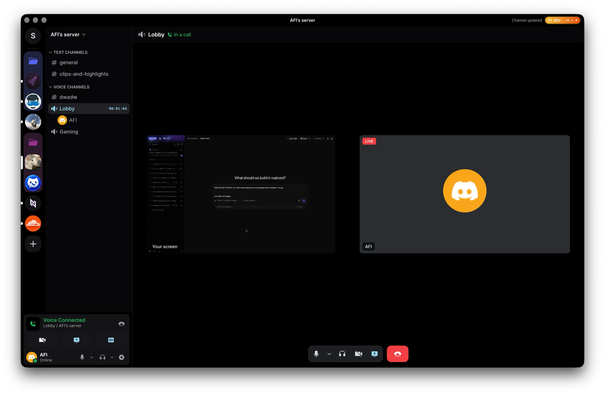 | 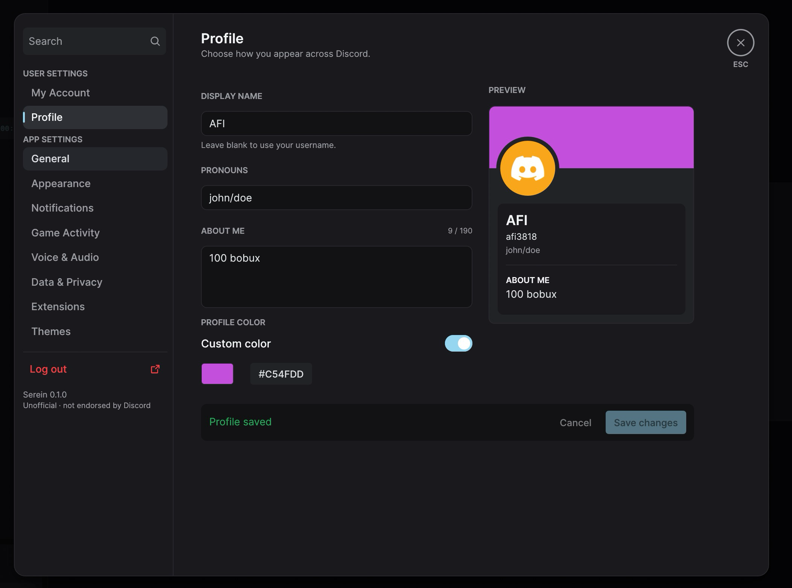 |
| **Administração de servidor** | **Threads e fóruns** |
| 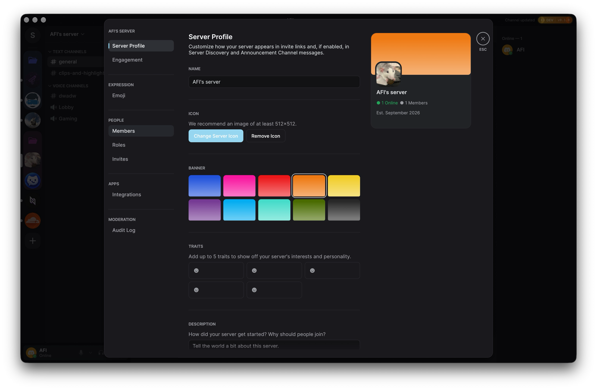 | 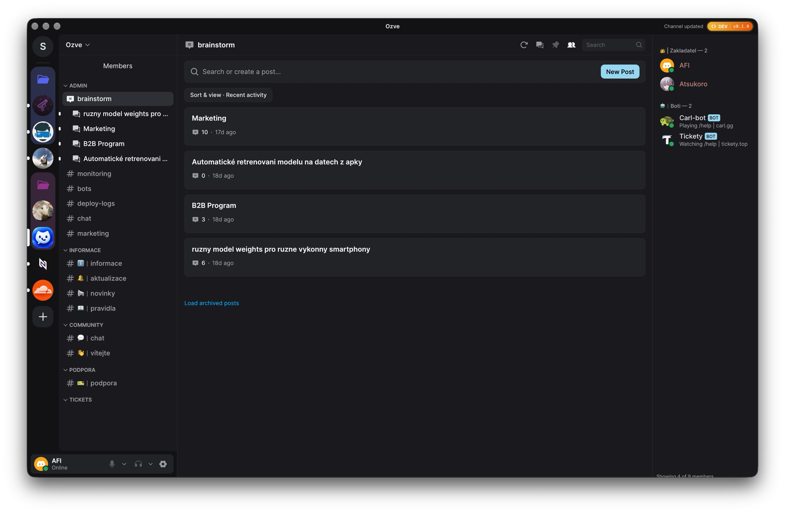 |
| **Envio de vários arquivos** | **GIFs e emojis** |
| 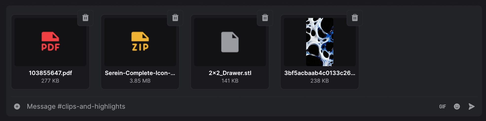 | 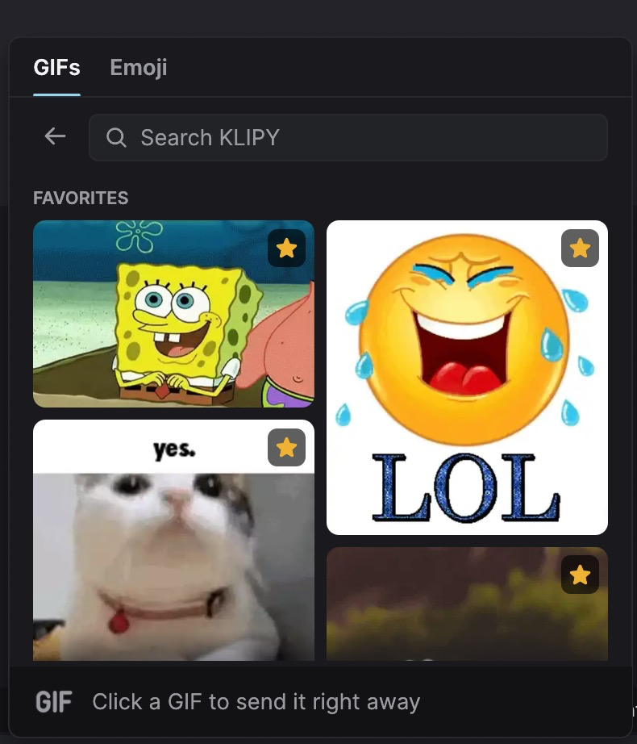 |

---

## 📊 Desempenho comparado ao Discord oficial

> **Cenário do teste:** navegando entre canais, conectado num canal de voz e transmitindo a tela a 60 FPS.

| Métrica | Discord oficial (Electron) | Monkado (Rust nativo + egui/wgpu) | Vantagem |
|---|:---:|:---:|:---:|
| **Memória (RAM)** | **1.178,4 MB** *(em 7 processos auxiliares)* | **129,7 MB** *(um único processo)* | **~9× menos memória (-89%)** |
| **Uso de CPU** | **22,8%** *(renderizador + auxiliares)* | **8,1%** | **~2,8× menos CPU (-64%)** |

| Discord oficial (Electron) | Monkado (Rust nativo) |
| :---: | :---: |
| **RAM: ~1.178,4 MB em 7 processos** | **RAM: 129,7 MB em um processo** |
| 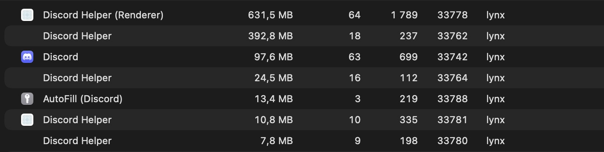 | 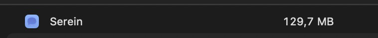 |
| **CPU: 22,8% no total** | **CPU: 8,1% no total** |
| 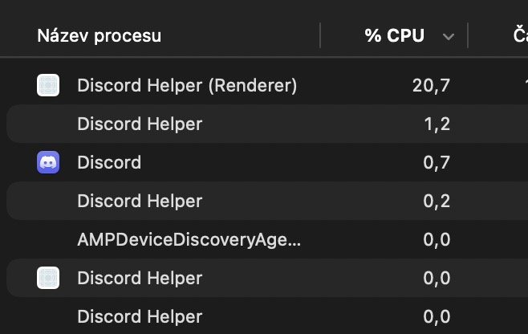 | 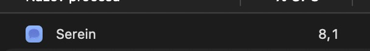 |

---

## 📋 Funcionalidades

| Recurso | Status | Detalhes |
|---|---|---|
| **Navegação e servidores** | Pronto | Categorias recolhíveis, ícones em cache, canais de servidor, fóruns, threads ativas, lista de DMs, painel de pessoas e menus de contexto |
| **Linha do tempo de mensagens** | Pronto | Lista virtualizada, confirmação de links, spoilers, faixa de não lidas, proteção de mensagens apagadas e horários no fuso local |
| **Markdown e mensagens de sistema** | Pronto | Negrito, itálico, blocos de código, citações, links clicáveis e eventos de sistema com ícones e nomes clicáveis |
| **Reações e emojis** | Pronto | Twemoji, contagem de reações, seletor rápido com oito emojis, seletor completo e emojis personalizados |
| **GIFs** | Pronto | Seletor KLIPY com busca, favoritos e envio em um clique |
| **Menções e autocompletar** | Pronto | Menções clicáveis com autocompletar no campo de mensagem |
| **Prévias de mídia e player** | Pronto | MOV, MP4 e WebM no app, salvar/copiar mídia, cartões de imagem e embed, galerias e visualizador em tamanho real |
| **Envio de arquivos** | Pronto | Vários anexos com selos de tipo, miniaturas, remoção individual, barra de progresso e arrastar e soltar |
| **Voz e calls** | Pronto | DM 1-a-1/grupo e canais de servidor, Opus, DAVE v1, Sonora AEC3, RNNoise, push-to-talk (`V`) e escolha de dispositivos |
| **Mensagens de voz** | Pronto | Reprodução com forma de onda interativa |
| **Compartilhamento de tela** | Pronto | Windows Graphics Capture, presets de qualidade (480p a 2160p, até 60 FPS) e prévia local — enviado via **P2P do Monkado** |
| **Câmera e assistir transmissões** | Pronto | Decodificação por hardware (DXVA/D3D11); câmera e tela dos amigos chegam via **P2P do Monkado** |
| **Selo AO VIVO** | Pronto | Mostra na call quem está compartilhando a tela ou com a câmera ligada, em DMs e servidores |
| **Threads e fóruns** | Pronto | Lista de posts, ordenação por atividade, threads ativas e criação de posts e threads |
| **Administração de servidor** | Pronto | Perfil do servidor, figurinhas, cargos e permissões, log de auditoria, convites, integrações/webhooks e moderação |
| **Extensões e temas** | Pronto | Plugins via Git, catálogo de temas com prévias e presets, pedidos de permissão e proteção de mensagens apagadas |
| **Atalhos de teclado** | Pronto | Folha de atalhos, edição rápida (`↑`), exclusão rápida (`Backspace`) e navegação pelo teclado |
| **Rich Presence e jogos** | Pronto | IPC e RPC do Discord, detecção de jogos e atividades nos perfis; ícone opcional na bandeja |
| **Perfis** | Pronto | Cartões de perfil com banner, bio, insígnias e conexões; editor de nome, bio, pronomes e cor com prévia ao vivo |
| **Ações de servidor e grupo** | Pronto | Convidar amigos, sair do servidor; editar nome/ícone do grupo, silenciar e sair |
| **Menus de contexto** | Pronto | Clique direito em mensagens, mídias, canais e membros |
| **Indicador de digitação** | Pronto | Mostra quem está digitando; o Monkado nunca envia o seu "digitando…" |
| **Dados locais e rascunhos** | Pronto | Cache SQLite limitado, token no Gerenciador de Credenciais e limpeza total ao sair |
| **Idiomas** | Parcial | Interface em português e outros idiomas; fontes com suporte a CJK e árabe; IME e texto bidirecional não verificados |

---

## 🏗️ Arquitetura

O Monkado é um workspace Cargo com vários crates, separando a interface da rede, do armazenamento e dos protocolos:

```
monkado/
├── apps/
│   └── desktop/          # Ponto de entrada, janela, P2P de tela/câmera
├── crates/
│   ├── client-core/      # Estado do cliente, eventos e reconciliação
│   ├── session-cache/    # Cache em memória com limite
│   ├── ui/               # Widgets egui, lista virtualizada, temas e design
│   ├── model/            # Entidades do Discord tipadas
│   ├── discord-protocol/ # Serialização do protocolo
│   ├── discord-api/      # Cliente REST HTTP/2 com limite de requisições
│   ├── discord-gateway/  # Gateway WebSocket com heartbeat e resume
│   ├── discord-voice/    # Opus, RTP/UDP, DAVE v1, AEC, RNNoise, vídeo e mesh P2P (iroh)
│   ├── local-store/      # Banco SQLite limitado (histórico, rascunhos, configurações)
│   ├── platform/         # Integrações com o Windows (credenciais, bandeja, notificações)
│   └── test-support/     # Dados sintéticos para testes
└── tools/
    ├── replay-bench/     # Benchmarks do estado
    └── xtask/            # Automação (pacote, checagens, lint)
```

---

## 🔒 Segurança e privacidade

- **Proteção do token:** fica no Gerenciador de Credenciais do Windows. A alternativa em arquivo só existe se você ativar em Armazenamento, e desativar apaga os arquivos. O token ativo fica mascarado na memória.
- **Cache com limite:** o SQLite guarda histórico recente, rascunhos, configurações e metadados de imagens, sempre com limite de tamanho e quantidade. O banco local **não** é criptografado pelo app.
- **Sair limpa tudo:** sair da conta encerra as sessões, apaga o token do cofre e remove o cache e os rascunhos daquela conta.
- **Zero telemetria:** nenhum analytics, rastreamento ou coleta de erros em segundo plano. O registro de diagnóstico é opcional (Configurações → Atualizações) e só guarda textos fixos e números, nunca mensagens.
- **Sem trapaças:** nada de burlar CAPTCHA/2FA, roubar tokens ou fingir ser bot. Toda conexão usa uma identidade de navegador consistente com o WebView2, sem rodízio para escapar de detecção.
- **P2P fechado na call:** só quem está na mesma call de voz consegue se conectar para ver sua tela ou câmera.

---

## 🛠️ Compilar a partir do código

### Requisitos
Rust **1.99.1** (fixado em `rust-toolchain.toml`), Visual Studio Build Tools 2022 com C++, CMake, NASM, Git, LLVM (libclang) e WebView2 Runtime. Para gerar o instalador, instale também o [NSIS](https://nsis.sourceforge.io/).

### Rodando localmente

```powershell
# 1. Conversas sintéticas, sem conta
cargo run --locked --features demo -- --demo

# 2. App normal com voz (usa o login salvo ou a tela oficial de login)
cargo run --locked
```

Builds de desenvolvimento guardam os dados numa pasta separada (`serein-development`), isolada da versão instalada. Use `SEREIN_DATA_DIR` com um caminho absoluto para separar mais cópias.

### Comandos úteis

```powershell
# Validação completa (formatação, Clippy, testes, políticas)
cargo xtask check

# Gerar o pacote em dist/ e o instalador em dist-installer/
cargo xtask package
```

---

## 📄 Licença

O código é licenciado sob **MIT** ([LICENSE-MIT](LICENSE-MIT)) ou **Apache 2.0** ([LICENSE-APACHE](LICENSE-APACHE)), à sua escolha. Avisos de bibliotecas de terceiros, fontes (Inter, Noto Sans CJK/Árabe) e gráficos Twemoji estão em [THIRD_PARTY_NOTICES.md](THIRD_PARTY_NOTICES.md).
